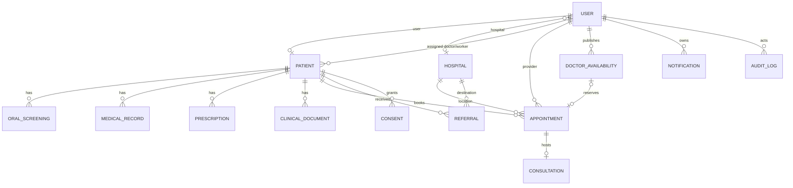

# Aarogya Drishti Database Schema

## Status and modeling principles

The current MongoDB models are defined in `backend/src/models/index.js` and exported as Mongoose models. This document maps the requested logical collections to the existing model(s), with gaps called out. It deliberately does not propose parallel collections where existing records already represent the same domain.

The schemas use MongoDB ObjectId references, timestamps, strict writes, Mongoose validators, and explicit indexes. Sensitive values are marked `select: false` where implemented. Database relationships do not provide authorization by themselves; API services must enforce ownership, role, and facility/care relationships.

### Requested entities mapped to current models

| Requested logical entity | Existing model / collection concept | Status and rationale |
|---|---|---|
| Users | `User` | Existing identity and role record. |
| Hospitals | `Hospital` | Existing facility directory. |
| HospitalManagers | `User` (`role: hospital`, `hospital` ref) | No separate collection; manager-specific fields are not currently defined. |
| Doctors | `User` (`role: doctor`) | No separate collection; approval status and staff ID are on User. |
| Patients | `Patient` plus `User` | Existing patient clinical/demographic profile is linked to login identity. |
| DoctorDocuments | None | No doctor credential-document model/API. Do not reuse patient `ClinicalDocument` for staff credentials. Create only after requirements, access, and retention are approved. |
| ConsentRecords | `Consent` | Existing consent record model. Screening-image consent is also captured on `OralScreening`; align purposes and avoid duplicate sources of truth. |
| ScreeningSessions | `OralScreening` | Existing screening encounter/session. |
| QuestionnaireResponses | Partial: `OfflineScreeningMetadata.symptoms`, `VoiceTranscript` symptom/transcript data | No dedicated questionnaire response model/versioned answer set. A distinct collection is a gap if structured questionnaire history is required. |
| OralImages | Embedded metadata on `OralScreening` plus encrypted object storage | Bytes are private encrypted objects; MongoDB stores opaque key, MIME type, digest, consent and timestamp. No separate image collection. |
| AIScreeningReports | Embedded `OralScreening.aiResult` | AI output and provenance are embedded in the screening; clinician assessment is separate embedded data. Not a validated diagnostic report. |
| Appointments | `Appointment` | Existing model. |
| DoctorAvailability | `DoctorAvailability` | Existing model. |
| VideoConsultations | `Consultation` | Existing model, one per appointment; includes room status, notes and chat messages. |
| ConsultationNotes | `MedicalRecord` and `Consultation.notes` | No dedicated consultation-note collection. Clinical notes are separate patient records; short consultation notes may be embedded. |
| FollowUps | `MedicalRecord` with `recordType: follow-up`, and/or appointment/referral workflows | No dedicated FollowUp model. Current follow-up is represented by medical records and/or scheduled appointments. |
| Notifications | `Notification` | Existing user-owned notification records. |
| AuditLogs | `AuditLog` | Existing audit event model. |

Related existing models include `HealthcareWorker`, `PatientQR`, `OfflineScreeningMetadata`, `VoiceTranscript`, `VoiceConversation`, `VoiceMessage`, `MedicalRecord`, `Prescription`, `ClinicalDocument`, `Referral`, `RefreshSession`, `PatientOtpChallenge`, `EducationArticle`, `EducationVideo`, and `EducationVideoHistory`. They are not redundant instances of the requested entities.

## Relationship overview

## Existing schemas, required data and validation

The summaries below document the current schema contract. Mongoose schema definitions remain authoritative for complete field types and validators.

| Model | Required fields / principal references | Validation and current indexes |
|---|---|---|
| `User` | `name`, `email`, `role`; optional `phone`, `staffId`, `hospital`, `district` | Email normalized lowercase and unique; role enum currently includes `patient`, `asha`, `doctor`, `specialist`, `hospital`, `district`, `admin`; optional staff ID unique with partial index; role/approval/active index. Password/reset hashes excluded by default. |
| `Patient` | `patientId`, `name`, `village`; optional `user` ref and demographic/location fields | Unique patient ID; status and gender enums; text index on name, ID, village, district; unique partial idempotency index on client actor/request ID. |
| `Hospital` | `name`, `village`; optional address, contact, district, services, bed count | Bounds for strings and beds; postal code pattern; active flag; sparse unique `directoryKey`; district/mandal/name and text indexes. |
| `HealthcareWorker` | `staffId`, name, role, phone, designation, facility, mandal, village, district, joined date | Staff ID unique; roles and employment status enums; facility reference; district/status/role and text indexes. |
| `Consent` | `patient`, `purpose`, `granted`; optional `grantedBy`, grant/revocation dates | Purpose length limit; patient reference indexed. Ensure `grantedAt` is set when consent is granted at service layer. |
| `OralScreening` | `patient`, category; optional `screenedBy`, AI result and review | Category/status enums; AI confidence 0..1; doctor review decision enum; patient/status/time and review indexes. Storage key/MIME/digest and image consent are excluded from default projection. |
| `OfflineScreeningMetadata` | client request ID, creator, patient, consent true, capture time, request hash | Consent validator requires true; symptoms bounded; hash excluded from default projection; unique actor/request ID supports idempotent sync. |
| `MedicalRecord` | patient, title, notes; optional author/type/date | Record type enum; title/notes max lengths; patient index. |
| `Prescription` | patient, medication, instructions; optional prescriber/status/dates | Status enum; bounded strings; patient index. Date order is validated in service logic. |
| `ClinicalDocument` | patient, uploader, type/title, storage key, MIME, digest, byte length | Document type enum; maximum 10 MiB; key/digest excluded from default projection; patient/date index. Bytes live in object storage. |
| `Appointment` | patient and scheduled time; optional provider, hospital, availability | Visit mode/status enums; provider/time/status and patient/time/status indexes. No dedicated urgency/priority field currently. |
| `DoctorAvailability` | doctor, start/end timestamps | Slot minutes 15..120; status enum; unique doctor/start-time; service validates future window and end > start. |
| `Consultation` | unique appointment, patient; provider optional | Consultation status enum; one consultation per appointment; room ID excluded from default projection; notes bounded; chat is an embedded bounded-text array per message. |
| `Referral` | patient, destination hospital, reason | Referral status enum; patient/status indexes; from-provider and destination refs. |
| `Notification` | recipient user, title, message; optional patient/type/metadata | Bounded strings; user/date and type indexes; unique sparse `dedupeKey` excluded from normal projection. |
| `AuditLog` | action, resource type; optional actor/resource/metadata | Bounded action/type; occurrence time index. Audit metadata must not contain credentials, tokens, or unnecessary clinical content. |
| `RefreshSession` | user, token ID hash, expiry | Unique token hash; TTL index on expiry; revocation and replacement references. |
| `PatientOtpChallenge` | phone, purpose, code hash, expiry, send time | Purpose enum; attempt bound 0..5; unique phone/purpose; TTL expiry; code hash excluded from default projection. |

Other model schemas include voice transcripts and conversation messages, education content, video history, QR-token hashes and referrals. Refer to `backend/src/models/index.js` for their precise required fields and indexes.

## Unique indexes and concurrency

Existing unique constraints include User email; partial User staff ID; Patient patient ID; partial Patient client request actor/request ID; HealthcareWorker staff ID; Hospital sparse directory key; DoctorAvailability doctor/start time; Consultation appointment; Notification sparse dedupe key; RefreshSession token hash; PatientOtpChallenge phone/purpose; PatientQR token hash; EducationArticle/Video slug where defined; and EducationVideoHistory user/video.

MongoDB unique indexes are the final defense against duplicate writes, but their creation and legacy data compatibility must be verified before deployment. Booking availability uses an atomic state transition to prevent a slot from being booked twice. Multi-document creation/cleanup should use transactions when the deployment supports them or explicit idempotency/compensation.

## Ownership and access rules

| Data | Ownership / authorization rule |
|---|---|
| User identity | Owner can read/update only allowed profile fields; admin staff workflows are restricted. Never return hashes or reset tokens. |
| Patient | Resolve patient self-service from authenticated `User`; do not accept arbitrary patient IDs as authority. |
| Clinical records, screenings, prescriptions, referrals and documents | Patient owner plus authorized clinical relationship; doctor relationship and facility scope must be checked on each route and file download. |
| Hospital and manager | Manager account is linked by `User.hospital`; manager writes must target only that facility. |
| Images and documents | Private encrypted objects; storage keys are opaque and not authorization tokens. Decrypt only after service authorization. |
| Consent | Patient/purpose specific; check grant/revocation state for each processing or access action that depends on consent. |
| Appointment/consultation | Patient, assigned/provider doctor, or authorized admin workflow; video access only for appointment participants. |
| Notifications | Recipient user only. |
| Audit logs | Restricted operational access; append events for sensitive operations and avoid unnecessary PHI in metadata. |
| Analytics | Aggregate outputs. District users are constrained to their district; do not return patient-level identifiers in analytics. |

## Proposed additions only after approval

The following gaps should not be addressed by duplicating existing models:

1. **Doctor credentials:** add a dedicated `DoctorDocument` model only for staff credentials, distinct from patient `ClinicalDocument`. Suggested fields: `doctor: User` required/indexed, `uploadedBy: User` required, `documentType` enum, `storageKey` required/hidden, `mimeType`, `sha256` hidden, `byteLength` bounded, `verificationStatus` enum, `reviewedBy`, `reviewedAt`, `expiresAt`, and audit timestamps. Store bytes privately encrypted. Add indexes on doctor/status and unique idempotency key if needed.
2. **Structured questionnaire:** add a `QuestionnaireResponse` only if the product needs immutable, versioned answer sets. Suggested fields: patient, screening session, questionnaire version, answers with bounded schema/key/value types, submittedAt, consent reference, and creator. Index patient/submittedAt and screening session; validate version and answer set in service. Do not keep duplicative symptom arrays in unrelated records.
3. **Urgent appointment handling:** add explicit priority/emergency request fields only after defining intake, triage ownership, response SLA, and safe escalation copy. A flag alone is not emergency care.
4. **Standalone reports/notes/follow-ups:** keep embedded/related existing data unless independent lifecycle, retention, or access patterns justify separate collections. Never split merely to mirror a relational table list.

## Data retention and deletion

No universal retention duration is encoded by the current schemas. Retention must be approved against applicable healthcare/privacy rules and operational requirements before setting TTL indexes or automated deletion.

| Data class | Recommended handling pending policy approval |
|---|---|
| Clinical records, screening reports, prescriptions, referrals, consultation notes | Retain according to approved medical-record schedule; no TTL by default. Preserve provenance and legal hold capability. |
| Screening images and clinical documents | Keep only for approved care purpose and retention interval; delete encrypted object and metadata together, with auditable result. |
| Consent records | Retain evidence of grant/revocation for the applicable period; do not silently expire consent history. |
| Audit logs | Retain based on approved security/compliance policy; protect against ordinary user edits and minimize PHI. |
| OTP challenges and refresh sessions | Expire via TTL at their configured expiry; hashes only, with bounded challenge attempts and token revocation. |
| Notifications and voice assistant transcripts | Define separate user deletion and retention policies; avoid indefinite retention by default. |
| Backups | Configure documented backup retention and deletion expiry; application deletion does not automatically erase historical backups. |

## Database operational checks

- Verify MongoDB connectivity/readiness; development server startup without DB is not proof of working persistence.
- Confirm actual collection names and index build status against the deployed MongoDB before migration or retention changes.
- Back up before schema/index migrations. Do not run destructive migrations without explicit approval.
- Ensure database transport/TLS, least-privilege credentials, encrypted backups, and access logging are configured by deployment.
- Monitor collection growth and bound embedded arrays; do not embed unbounded chat/history/event arrays.
