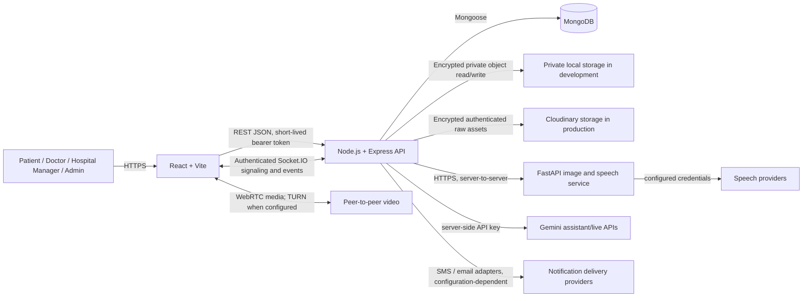

# Aarogya Drishti System Architecture

## Status and scope

This document describes the existing application and a proposed four-role product mapping. It is an architecture/design artifact only: it does not change application code, database data, deployed services, or role assignments. Implementation changes require approval after review of this document and the companion design documents.

The current application is a React/Vite frontend, an Express/Node.js API, MongoDB through Mongoose, a separate FastAPI service, private file storage, and Socket.IO/WebRTC for realtime communication. Retain these boundaries; do not introduce a second API, duplicate domain collections, or a new project.

## Logical architecture

### Existing component responsibilities

| Component | Responsibility and current implementation |
|---|---|
| React + Vite | Responsive UI, route redirects, i18next language selection, forms and dashboard views. Client checks are convenience only, never authorization. |
| Express API | Authentication, role and relationship checks, validation, domain workflows, file access, and REST endpoints under `/api`. Helmet, CORS allow-list, JSON limits, and rate limits are configured. |
| MongoDB / Mongoose | Domain records and references. Schemas use timestamps and strict writes; selected secrets/file metadata are excluded from default projections. |
| FastAPI service | Image upload processing and speech/transcription/translation functions. Current oral-image adapter is demonstration output, not a validated clinical model. |
| Gemini integration | Backend Gemini service supports assistant/live workflows. The oral-image upload path currently calls the FastAPI `/analyze` endpoint; the code does not establish a production Gemini oral-screening pipeline. |
| Private file storage | Application encrypts screening images and clinical documents using AES-GCM before storage. Development can use a private local directory; production uses authenticated Cloudinary raw assets and serves downloads through existing API authorization. |
| Realtime/video | Socket.IO authenticates users and performs signaling; WebRTC carries media between participants. TURN credentials are generated when configured. Appointment participants are checked before room access. |
| Notifications | MongoDB notifications are scoped to a user and emitted to authenticated user rooms. Appointment reminders are scheduled by the API process. External SMS/email delivery is configuration-dependent and is not equivalent to in-app notification persistence. |

## Request and trust boundaries

1. A user authenticates through the API. Patient registration/sign-in may use phone OTP; staff authenticate using account identifier and password. Access tokens are short lived, refresh sessions are stored as hashes and rotated, and refresh tokens are delivered through an httpOnly cookie.
2. The API resolves the authenticated user from the token. Each protected action must also check role and, where applicable, the patient-care, doctor-assignment, hospital, or appointment relationship. Frontend routes do not provide security.
3. Sensitive uploads are validated by size, MIME type and file signature; application code encrypts bytes before storage. MongoDB stores opaque keys and metadata, not image bytes.
4. Only the backend calls the AI service. The browser must never receive Gemini, AI-service, storage, SMTP, SMS, JWT, or TURN shared secrets.
5. AI observations and clinician assessment are distinct. AI results are not a diagnosis and must not be presented as confirmed disease; the current image adapter is explicitly demonstration-only.
6. User notifications are read and updated only by their owner. Realtime events are emitted to authenticated user-specific rooms. Video signaling rooms are restricted to appointment participants.
7. District analytics return aggregates and constrain the district filter to the authenticated district. Patient-level records must not leak into aggregate endpoints.

## Role mapping: current code versus requested product

The requested product names four roles. The user approved preserving all current role values and records, mapping `hospital` to the Hospital Manager product label, and retaining `asha`, `specialist`, and `district` flows without migration. Platform administrators are limited to aggregate analytics and operational metadata; patient-level clinical records are not accessible by default. Hospital Managers are limited to facility operations and assignment metadata; clinical access requires a separate clinician role.

| Product role | Existing role value | Existing profile/linkage |
|---|---|---|
| Patient | `patient` | `Patient.user` links the patient profile to `User`. |
| Doctor | `doctor` | Doctor is a `User` with role `doctor`; approval state is on `User`. No separate Doctor collection exists. |
| Hospital Manager | `hospital` | Hospital staff user linked through `User.hospital`; this is the current equivalent. No HospitalManager collection exists. |
| Admin | `admin` | Platform administrator `User`. |
| Existing additional roles | `asha`, `specialist`, `district` | Community worker, specialist, and district analytics workflows exist; these are not part of the requested four-role matrix but must not be silently removed or remapped. |

## Target service boundaries

- **Authentication and identity:** keep `User` as the identity record; maintain phone OTP for patient access and staff password login. Apply approval and active-account checks server-side.
- **Hospital operations:** keep `Hospital` as facility metadata and associate hospital managers via `User.hospital`. A dedicated manager profile should only be introduced if an approved requirement adds manager-specific fields that cannot reasonably live on `User`.
- **Clinical workflow:** keep patient-owned clinical records, screenings, appointments, referrals, and documents referenced by Patient/User IDs. Enforce least privilege at the service layer.
- **Screening:** accept consented inputs, preserve image-quality failure and uncertainty, record provenance and a model/version when a real model is approved, and route results for clinician review. Do not equate preliminary risk categorization with diagnosis.
- **Files:** use private encrypted object storage, opaque generated keys, access through authorized API routes, and auditable deletion. No public object URLs.
- **Video:** use appointment-based authorization and short-lived signaling credentials; do not persist recordings by default. Any recording feature would require a separate explicit consent, retention, and security design.
- **Notifications:** persist user-scoped in-app events; add external delivery only through server-side providers with delivery status and retry policy.

## Operational configuration boundary

Production configuration is expected to include HTTPS frontend/API/AI URLs, explicit CORS origins, MongoDB Atlas URI, distinct strong access/refresh JWT secrets, image encryption key, Cloudinary credentials, AI service URL/token, and optional TURN, Gemini, SMS, and email credentials. Secrets belong in deployment secret stores, not source control or frontend environment bundles.

The API currently permits a development server to start when MongoDB is unavailable. A live process or successful frontend response therefore does not prove database readiness; use the health endpoint and verify database state before claiming that a workflow is operational.

## Known gaps and decisions requiring approval

1. The requested Gemini oral-image assessment is not implemented as a verified production capability. Current image responses are demonstration-only through FastAPI.
2. Separate `DoctorDocuments`, questionnaire response, oral-image, AI-report, consultation-note, and follow-up collections do not exist. Current equivalent data is embedded or stored in existing domain models, as detailed in [DATABASE_SCHEMA.md](./DATABASE_SCHEMA.md).
3. Current roles include ASHA, specialist, and district in addition to the four requested product roles. Decide whether they remain supported, are restricted, or are migrated before changing role validation.
4. Hospital Manager is represented as role `hospital`, not `hospital_manager`; ensure UI labels do not imply a separate schema.
5. Retention periods depend on applicable healthcare/privacy rules and organizational policy. Proposed categories in [DATABASE_SCHEMA.md](./DATABASE_SCHEMA.md) are not legal determinations and need approval.

## Companion design documents

- [DATABASE_SCHEMA.md](./DATABASE_SCHEMA.md) — existing model mapping, relationships, indexes, ownership, validation, gaps, and retention recommendations.
- [API_DOCUMENTATION.md](./API_DOCUMENTATION.md) — current API surface and authorization model.
- [ROLE_PERMISSION_MATRIX.md](./ROLE_PERMISSION_MATRIX.md) — product roles, existing role values, and access boundaries.
- [USER_WORKFLOW.md](./USER_WORKFLOW.md) — end-to-end patient, doctor, manager, and admin journeys.
